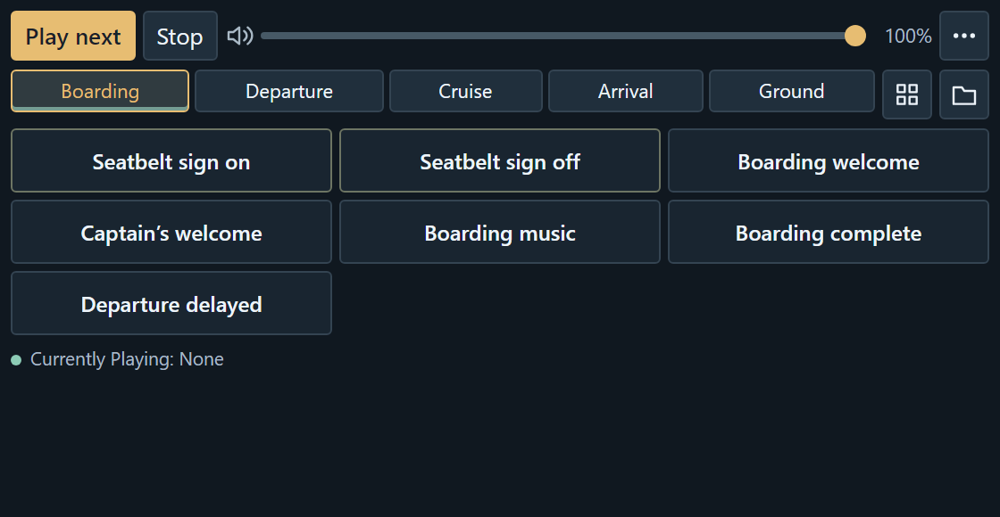
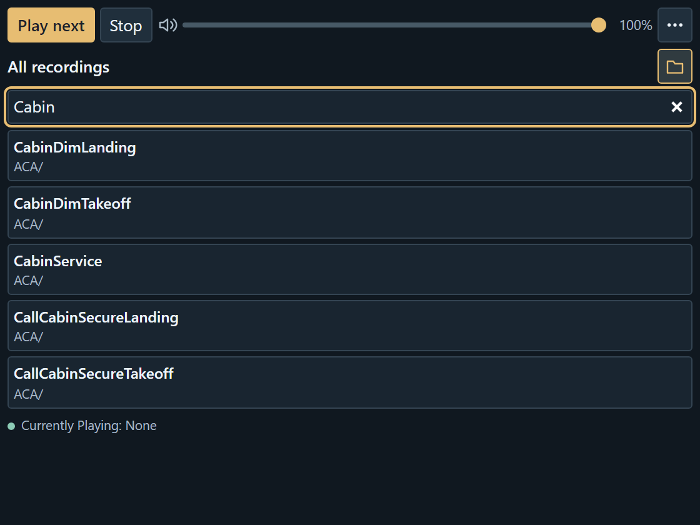
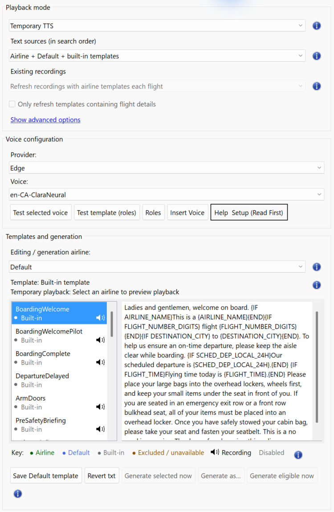

# Universal Announcer

Cabin announcements for **Microsoft Flight Simulator 2020, MSFS 2024 and X-Plane 12 (beta)**, running on Windows.

## User manual

Start with the manual for installation, sound packs, flight steps and app settings:

- **[Read the HTML manual](https://fearlessfrog.github.io/MSFS_Universal_Announcer/manual/)**
- **[Download the PDF manual](https://fearlessfrog.github.io/MSFS_Universal_Announcer/manual/UniversalAnnouncer-User-Manual.pdf)**

Universal Announcer follows your flight and plays boarding welcomes, music, safety briefings, cruise calls and arrival announcements. Use compatible recordings, generate speech with your flight details, or mix the two. Fenix ownership is not required.

## Features

- **MSFS and X-Plane:** automatic flight-state detection from aircraft lights, engines, movement and altitude. The app detects your running simulator automatically. X-Plane 12 support is currently beta and uses its built-in local API, with no plugin to install.
- **Aircraft switches and profiles:** teach the app an exposed boarding, light, seatbelt or parking-brake control; import and export profiles. Bundled X-Plane mappings cover the Laminar 737, LevelUp 737NG, ToLiss A319/A320/A321 and FlightFactor 777. Signal availability varies by aircraft.
- **Airline sound packs:** use older Fenix-format and Fenix V3 collections, with airline folders, aircraft/family variants, numbered alternatives, time-of-day, airport and route tags.
- **Three playback choices:** Recordings only, Recordings + TTS, or Temporary TTS without changing your pack. Choose permitted text sources and whether to keep or refresh recordings; preview what manual generation will create, refresh or skip.
- **Voices and flight-aware text:** Windows offline voices, Edge, Azure, ElevenLabs and OpenAI-compatible local or hosted TTS servers. Assign Pilot/Flight Attendant roles, use automatic country-based voices, and test either the selected voice or the template's roles.
- **SimBrief flight details:** select airline and aircraft packs, expand flight details in templates, and schedule optional cruise, top-of-climb and descent calls.
- **Everyday controls:** a desktop Announcement panel, recording browser, system tray controls, hotkeys and controller bindings. Play a particular call, advance the sequence, stop, mute or reset the flight.
- **Cabin audio:** separate announcement/music levels, camera-based cockpit/cabin/external volume, optional cabin ambience and a PA effect for generated speech. X-Plane supports per-aircraft cabin-boundary calibration.
- **MSFS integrations:** an optional in-simulator toolbar, GSX boarding/deboarding/refueling, ChasePlane camera support, smoke/tailhook command bindings and optional landing reactions/ratings. These integrations are MSFS-only.

## See the app

**Announcement panel** — everyday calls, flight-stage banks, playback controls and volume. The desktop panel works with either simulator; MSFS also has an in-simulator toolbar.

**Recording browser** — search your collection and choose a particular announcement or variant. This example filters an ACA collection for cabin calls.

**Generated announcements** — choose playback mode, text sources and voices, then edit templates using your flight details. This example uses Temporary TTS, so recording-generation controls are disabled; the choices shown are saved settings, not defaults.

Click a screenshot to view it full size. The [user manual](https://fearlessfrog.github.io/MSFS_Universal_Announcer/manual/) walks through these controls and the rest of the app.

## Requirements

- **64-bit Windows 10 or 11**, including when using X-Plane.
- **MSFS 2020, MSFS 2024, or X-Plane 12.1.4+** with API v2 available on the same computer. See [X-Plane 12 appendix](https://fearlessfrog.github.io/MSFS_Universal_Announcer/manual/#xplane-setup).
- The normal self-contained release includes its .NET runtime. The desktop Announcement panel also needs Microsoft Edge WebView2 Runtime.
- Compatible announcement recordings or a configured speech provider. Online providers need internet access; Azure, ElevenLabs and hosted services may require accounts and payment.

## Quick start

1. **[Download a release](https://github.com/fearlessfrog/MSFS_Universal_Announcer/releases)** and extract the whole application ZIP into its own writable folder. Run `UniversalAnnouncer.exe`; look in the Windows system tray if the window is hidden. Use a build whose release notes include the features you need; this manual covers v1.0.3.2 and the X-Plane beta.
2. **Load a flight** in your simulator; the app detects it automatically. Check Status for the connection. For the optional MSFS toolbar, install the matching supplied toolbar package in Community; the main app stays outside Community.
3. **Set up sounds** with Sound Files > Run setup… to download the starter pack or select existing files. You can also use compatible community packs or [generate your own announcements](https://fearlessfrog.github.io/MSFS_Universal_Announcer/manual/#generated). No copyrighted Fenix announcement pack is bundled with the app.
4. **Check your flight and audio:** fetch your latest SimBrief plan, or set airline/aircraft overrides on Status. Choose an audio device and preview a recording.
5. **Start boarding:** use GSX in MSFS, or the aircraft's mapped logo/boarding control. If a switch is unavailable, use Play Next or [learn an aircraft control](https://fearlessfrog.github.io/MSFS_Universal_Announcer/manual/#aircraft-switches). Follow the [flight walkthrough](https://fearlessfrog.github.io/MSFS_Universal_Announcer/manual/#departure).

The manual is the current guide. Older reference pages remain available, but can describe earlier controls and behavior.

## Sound packs, help and feedback

- [Sound-pack setup and community packs](https://fearlessfrog.github.io/MSFS_Universal_Announcer/manual/#sound-packs). Announcement Hangar is an independent, unaffiliated community; packs come from their authors.
- [Troubleshooting and collecting a debug log](https://fearlessfrog.github.io/MSFS_Universal_Announcer/manual/#support), then [report an issue](https://github.com/fearlessfrog/MSFS_Universal_Announcer/issues). Include app/simulator versions, aircraft and what happened.
- [Help translate the app](https://fearlessfrog.github.io/MSFS_Universal_Announcer/localization.html). The interface and built-in templates support English, German, French, Spanish, Italian, Brazilian Portuguese, Japanese, Simplified Chinese and Korean.
- Settings, logs and user aircraft profiles live under `%APPDATA%\UniversalAnnouncer`. Sound packs remain in your chosen sound folder.

Thanks to everyone who reports bugs, shares packs and profiles, translates the app or buys me a coffee.

## License and disclaimer

This free software is provided "as is" without warranty, for educational and entertainment purposes. Obtain sound packs from their authors or other authorized sources and follow their terms. Users are responsible for compliance and assume all risks.

SimConnect is © Microsoft Corporation. Universal Announcer is independent and is not affiliated with or endorsed by Microsoft, Laminar Research, FenixSim, Navigraph or FSDreamTeam.
